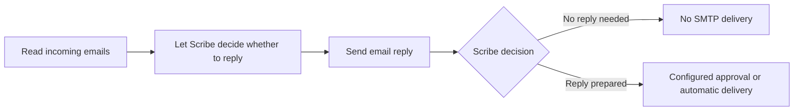

# Email intelligence pipelines

Email collection, graph persistence and retrieval are separate checkpoints. A
message appearing in the Email page proves collection only. `ingested` means the
Gateway upload was finalized; it does not claim that downstream outputs finished.
Check the durable execution of both outputs before claiming full indexing.

## Create and publish

Open **Pipelines**, then **Create pipeline**. The editor can open authored drafts,
append versions, load older versions, publish the saved graph, and retire it.
Conflicting edits preserve the local graph. Linked pipelines use immutable
published revisions and live permissions. Composition retains its existing limits:
three transfers to other pipelines and 256 blocks after expansion; cycles fail.

For an email pipeline, replace the initial input with the **Email accounts** block
from the installed block picker. Choose the JSON parser and `email` input group.
For one account, restrict `match_pattern` to
`email-ACCOUNT_ID-[a-f0-9]+\.json$` using its non-secret connection ID.
Credentials belong exclusively in User settings → Email.

Connect the input to **Email participants and chronology**, then connect that
block to two parallel outputs:

- **ESKG persistence** stores the canonical event, participant observations and
  source authorization. The timestamp comes from the message's Date header;
  malformed dates retain the authenticated collection time. Header identities
  describe observations, not verified identity claims.
- **HippoRAG2 evidence memory** extracts source-bound facts and embeds bounded
  passages through Scribe, then persists their provenance and model profile.
  Query-time HippoRAG2 ranking receives only currently authorized event evidence.
  An index row without a visible ESKG event grants no access.

Native regex, metadata and Scribe model routers can precede outputs or select
additional branches. Their paths can inspect `record.raw_payload.content` and
headers such as `record.raw_payload.metadata.sender`. These routers remain core
features. Inference-derived proposals remain evidence; ontology membership still
requires the Registry's validated active ontology slice.

Publish the graph, then enable **collection into pipelines** in the account's
connection settings. Compose and Kubernetes provide the native Gateway ingestion
endpoint and allowlisted storage origin. Override
`UTILS_INGESTION_STORAGE_ORIGINS` when the deployment's presigned storage origin
changes. This allowlist is deployment configuration, never pipeline data. Custom
input services can continue using their existing bearer-token configuration.

## Reply through a pipeline

For a conditional reply, connect these installed `utils` blocks:



The decision block (`utils.algorithm.decide_reply`) reads the canonical collected
message and bounded conversation context. Its short **When should Scribe reply?**
instruction can say, for example: "Answer direct questions about delivery dates.
Do not answer acknowledgments or purely informational messages." Choose a Scribe
model alias when needed and optionally read attachments. The same model call
decides whether an answer is useful and prepares its body when it is.

The block writes `email_reply_decision` and, when applicable, `email_reply` into
the payload. A declined decision produces no draft. The email output verifies
the persisted decision and skips SMTP when it says no. Decisions are encrypted
and scoped to tenant, mailbox, message, pipeline and immutable revision; replay
does not repeat successful inference or delivery. A deployed graph containing
this decision block cannot invoke the email output without its matching decision.
Model failure or malformed output fails the step without granting sending
authority. Other downstream analysis steps can still consume the decision.

For this deployed-graph workflow, select the receiving account in the input and
configure **Send email reply** with its sender and delivery mode. Automatic
delivery still requires the account's automation rights and its existing loop
and quota checks. Approval and draft modes retain human review. Historical
imports cannot trigger this automatic response path.

For analysis without replying, insert **Read email conversation and attachments**
(`utils.algorithm.email_context`). It writes an `email_context` snapshot for the
next step and requires no reply output or legacy response profile. The snapshot
prioritizes the requested message and includes up to eight collected messages,
two attachments per message, 4,096 characters per body/attachment preview and a
24,000-character aggregate text budget. Truncation and extraction warnings are
explicit. Full authorized attachment reads can continue separately. Context
extraction performs no embedding or indexing. With a deployed input, attachment
uploads are finalized before their email envelope even when optional document
ingestion is disabled.

The existing explicit composition/legacy profile workflow remains available:

Add **Prepare or send an email reply** on the selected branch. After publishing,
select that exact pipeline version in the account's response profile. The account
owner must be able to execute the pipeline. Configure the Scribe model, prompt,
skills, signature and approval mode there. The pipeline carries no sender
credentials and cannot select a different sending account.

Automatic mode additionally requires explicitly allowed senders and the separate
account automation permission. The service rechecks the owner's live identity,
current publication, connection status, canonical stored message, quotas and loop
protection. A later publication invalidates the previous binding until the owner
selects it again. Duplicate deliveries cannot produce a second reply. Uncertain
SMTP deliveries stay uncertain and are never retried automatically.

Vision workers need the deployment-provided `UTILS_SERVICE_URL` and a read-only
`UTILS_SERVICE_KEY_FILE`. Compose and the Kubernetes Vision deployment mount these;
external Ray worker deployments must mount the same workload configuration.
Never copy these values into a graph or model prompt.

## Query a chronology

`evidencePage` uses a half-open UTC period `[fromMs, untilMs)` and optional sender,
recipient, thread, linked Pengolo document and ontology filters. The authenticated
session supplies tenant and user; callers cannot supply another identity.

```graphql
query {
  evidencePage(
    filter: {
      fromMs: 1790812800000
      untilMs: 1793491200000
      recipient: "recipient@example.org"
    }
    limit: 20
  )
}
```

The existing `JSON` scalar returns a JSON-encoded page containing `items`, `after`,
`engine` and `warnings`. Pass `after` back with identical filters to continue.
Without `query`, results are chronological canonical events. With `query`, indexed
passages are ranked using HippoRAG2. The engine and warnings disclose degraded
ranking rather than claiming graph retrieval when inference is unavailable.
Queries scan bounded windows; continue until `after` is null for a complete
chronology. No hidden totals are returned. Every page rechecks event permissions;
document and ontology selectors require their own visibility too.

Pengolo's native `search_evidence` tool exposes the same bounded filters and records
the returned event provenance for replay. It complements `document_search`, which
retains the existing library-file ownership and checksum checks.
