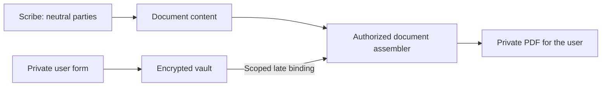

# Plugin extensibility boundary

Status: audit and required design constraints for the pending law plugin. The
execution-profile mechanism described below is a target contract, not an API
already implemented by the current manifests.

A plugin using supported extension contracts must not require edits to Gateway,
Scribe, Registry, Vision or the dashboard to execute. The host can acquire a new
generic extension point once; adding another plugin that uses it must then be a
manifest, implementation and resource deployment operation. Installing untrusted
third-party code is a separate trust boundary from deploying a reviewed bundle.

## Current evidence

| Path | Observed behavior | Assessment |
| --- | --- | --- |
| `front/dashboard/app/utils/ontology.ts`, `useOfficialOntologyLabels.ts` | Official ontology IDs select frontend translations; unknown packages use supplied labels. | Optional presentation integration, not an execution dependency. |
| `services/gateway/src/adapters/outbound/database/pengolo.rs`, `domain/pengolo.rs` | Tool checkpoints retain a text offset and a validated operation category. | Generic conversation protocol; do not require a new hardcoded operation for each plugin. |
| `platform/registry/src/plugin_ontology.rs` | Production materialization validates resource closure, mappings, limits and provenance. Legal IDs occur in tests below `mod tests`. | Generic production boundary; legal fixtures are not runtime coupling. |
| `plugins/src/galadril_plugins/registry.py` | Manifests bind namespaced capabilities to packaged handlers, tools, models, Skills and resources. | Existing generic execution path for trusted deployments. |
| `plugins/src/galadril_plugins/ontologies.py` | The shared ontology class derives administrative, civil and criminal views specifically for `law.contentieux`. | Business projection in the shared SDK; move generation/data into the law package. |
| `services/gateway/src/domain/pengolo.rs`, `application/usecases/pengolo.rs` | Legal branch enums, capability-name parsing, defense Skill identity and defense sharing influence admission. | Pending law-specific host coupling; replace with validated generic execution profiles. |
| `machine-learning/scribe/python/galadril_scribe/teams.py`, `contracts.py`, `runtime.py`, `instructions.py` | Legal identity selects context restrictions, legal writing instructions and a separate defense agent. | Preserve the isolation guarantees through a generic mechanism; move legal meanings and prompts into the plugin. |
| `services/gateway/src/adapters/inbound/mail_policy.rs`, `machine-learning/scribe/python/galadril_scribe/runtime.py` | Native email integration recognizes specific utils capability IDs and enables the email toolset. | Existing first-party adapter. Other connectors must have a generic path, rather than adding another ID exception. |

The current loader scans packaged `galadril_plugins` resources and limits factory
imports to the declared plugin namespace. It does not implement a third-party
marketplace, tenant-supplied imports, arbitrary wheel installation or isolation
of untrusted Python running inside a host process. Supporting those would require
an explicit installation and execution security model.

## Ownership of behavior

The plugin owns domain vocabulary, ontology modules and views, document templates,
workflow instructions, specialist roles and declared compatibility. In particular,
French litigation branches and the meaning of a defense role belong to law.
Existing public identifiers and saved ontology data must remain stable.

The host owns tenant/project authorization, credential custody, validated catalog
registration, immutable version selection, tool budgets, isolated contexts,
communication routing and human approval. A plugin can request a narrower context
or an approval requirement; it cannot grant itself additional access. The model
and frontend cannot create or relax an execution profile.

The target generic profile contract must cover:

- An opaque, namespaced workflow context and explicit compatible capability IDs.
  Compatibility must not be inferred from strings such as `law.*`.
- Explicit team membership and roles, separate from the existence of a Skill.
  A Skill is not automatically an independently useful specialist.
- Context policies: permitted current inputs, explicitly shared attachments,
  history, personal instructions and authorized tools. Sealed participants receive
  only their approved input package.
- Communication policies: orchestrator-mediated findings and participants that
  cannot consult peers, receive internal strategy or access shared scratch state.
- Output treatment: attributed reports remain untrusted evidence; a specialist's
  output never grants tools, changes scopes or approves an external action.
- Progress rendering: registered capability identity and bounded public labels
  flow through generic host events. Unknown presentation metadata falls back to
  a neutral tool display; a status event never authorizes execution.

Profiles must be resolved from the registered, version-pinned plugin configuration
and intersected with host authorization. Unknown profiles or unsupported policy
features fail before execution. Declaring a profile is not evidence that a plugin
is trusted or authorized. The shared catalogs must validate the same contract in
Gateway and Scribe before a plugin can depend on it.

## Migration and acceptance

1. Keep generic conversation events and optional frontend translations. Retain
   plain manifest labels for plugins without official translations.
2. Move legal ontology view generation into law resources or an offline package
   build step. Public metadata discovery must not import domain execution code.
3. Add the generic execution-profile contract and its admission/context checks.
   Preserve legacy saved fields through an explicit compatibility migration;
   changing field names alone does not remove coupling.
4. Express the three legal branches, legal writing workflow and isolated defense
   participant through that contract. Remove their identity checks from services.
5. Describe native email selection and approvals through reusable provider/resource
   contracts where needed. Existing email UI can remain an optional specialization;
   a different plugin must not require another hardcoded native adapter.
6. Exercise an independently named fixture plugin through discovery, pipeline
   execution, Scribe tools/Skills, team selection, ontology materialization and
   source rendering, without modifying host source files.

The fixture suite must cover renamed plugin/domain identifiers, unavailable
bindings, incompatible contexts and dependencies, version mismatches, a second
tenant/project, denied operations, sealed-participant leakage, orchestrator-only
communication and replay of saved selections. Assertions must check executed calls
and received contexts, not just catalog visibility or prompt wording. A runtime
failure must not silently widen context or substitute a more privileged tool.

The existing neutral fixture, binding-contract and Scribe integration tests
establish part of the trusted generic path. They do not establish the proposed
execution profiles, safe installation of untrusted plugins, or complete legal
workflow portability. Those remain acceptance gates before publishing law.

## Private inputs and late document binding

The claimant's name, address and other private profile fields must be entered
through a dedicated private form, not chat messages, `ask_user` answers, prompts
or generated tool arguments. The existing law template separates
`information.tex`; this is an injection point, not an encrypted storage facility.
An encrypted generic vault and its authorization/rendering integration remain
to be implemented.

The vault is a host capability available to registered plugins. Store entries
under verified tenant, owner, optional project, plugin namespace and schema
version. Encrypt authenticated payloads using maintained cryptographic libraries,
random nonces, deployment-managed keys and an explicit key version. Bind the
entry's security context to the authenticated encryption. Neither the ciphertext
database nor the plugin bundle stores the encryption keys. Support revision
checks, revocation/deletion and key rotation without changing stable references.

Plugins can declare private input schemas and required document bindings. This
declaration grants no access. Distinguish write, human-read, use-for-render and
export rights. A model-executed plugin has no generic plaintext read right. The
normal Scribe path receives neutral party tokens and no vault credentials or
plaintext values. Keep record IDs and binding grants outside its context where
possible; an opaque reference alone is never authorization.

The host authorizes use against a pinned template version, an allowlist of
private variable slots, a profile revision and the current actor/project.
Resolve bindings through a renderer-specific authority that is never returned
to Scribe. A renderer does not accept a model-supplied arbitrary vault path,
recipient, namespace or secret field selection. Public jurisdiction and
administration addresses can stay in ordinary verified document data.

Resolve private values only after claiming the compilation job, immediately
before rendering in the isolated working directory. The current compiler stores
its `Submission` before execution, so injecting values into the initial
`Document` request would put plaintext into persistent job storage. Queue only
opaque authorized references. Avoid private values in persisted rendered source,
errors, compiler logs, traces, caches, document names or tool return values.
Inject private scalars through the existing literal LaTeX escaping contract;
they must not become executable macros.

The resulting PDF necessarily contains the claimant's details. Keep it private
and protected at rest; do not automatically index it, return its text through
`read_file`, or send it as model-readable evidence. If analysis is required,
produce a separate redacted artifact from the same neutral content. The same
boundary applies to generated TeX/ZIP exports and to imported documents that
already contain these private values. User download or an explicitly authorized
recipient is distinct from model access.

Acceptance tests must prove that known private test values never appear in the
Scribe request/history, question/event replay, search/index payload, queue object,
tool results or telemetry. Also test two tenants/projects/plugins, a guessed
reference, changed template/profile revisions, revocation, LaTeX metacharacters,
compiler failure logs, artifact readback and approved export. These are generic
host guarantees; law declares the claimant schema and its bindings.

## Scoped pseudonymization before model admission

Status: required design, not a deployed sanitizer. Initials are display labels,
not identity keys or a claim of irreversible anonymization. Reversible mapping
data stays in the encrypted vault; the model receives a separate public alias,
never the vault entry identifier or its resolution authority.

A protected document profile must run before Scribe receives any content. An
ordinary Scribe tool that receives the raw document and returns redacted text is
too late. The boundary covers prompt/history, extracted text, OCR, image inputs,
attachments, retrieval passages, tool responses, URLs, metadata and filenames.
No remote model may receive the raw content to perform this preprocessing.
Originals remain in separately authorized private storage.

The plugin may declare a generic privacy profile, with a `secret` UI shorthand if
useful. A profile must specify pseudonymized model access, contact-data removal,
case-local mappings, uncertain-identity handling and permitted outputs. This is
an extension of the proposed profile contract, not a manifest field supported
today. The host resolves and enforces the registered policy. Unsupported profiles
or missing preprocessing must reject model admission rather than fall back to
ordinary chat. A plugin descriptor or client-supplied `redacted: true` is not
proof that processing occurred.

### Lightweight identity handling

1. Assign a stable case-local person identifier from verified structured party
   records, the private profile or explicit user confirmation. Keep observations
   and their source/page/offset separate from assertions that two names identify
   the same person. Do not link people across dossiers automatically.
2. Build a private alias index of verified full names, surname variants and
   supplied alternate spellings. Normalize Unicode, casing, spaces, apostrophes
   and hyphens for matching while preserving offsets in the original document.
   Token boundaries and longest full-name matches prevent substring replacements.
3. Match complete names first. A surname-only mention can inherit a person
   identifier only when the approved candidate set is unique. A nearby complete
   name, role or title can supply review context; proximity, a guessed gender or
   fuzzy spelling similarity must not silently resolve an ambiguity.
4. Produce the requested readable initials. A compound first name such as
   Jean-Daniel contributes J. in this display convention, so the full synthetic
   name Jean-Daniel Durand becomes J. D. and Monsieur Durand becomes Monsieur D.
   when the latter is uniquely linked. Both mentions retain the same person ID.
5. Preserve distinct identifiers for homonyms and initial collisions. If two
   people display as J. D., append a neutral case-local disambiguator such as
   `J. D. [person 1]` and `J. D. [person 2]`. A mention of Monsieur Durand with
   multiple candidates is unresolved; it is not assigned to the most recent
   candidate. Require private review before releasing a document with unresolved
   sensitive mentions.

Use bounded token dictionaries/tries and bounded contact recognizers as the
default CPU path. Local entity detection can propose unknown names for review;
it is not an identity authority. OCR errors and unidentified people are evidence
limits, not permission to forward the original. Avoid sending the alias roster
or source snippets to a model to settle an ambiguity.

Email, telephone, postal-address, signature and correspondence-header spans are
removed or replaced with typed neutral markers. Detecting contact data does not
prove that two people are identical: phone numbers and addresses can be shared.
Combine authorized known values with recognizers and private review of uncertain
spans. Protect norm citations, case numbers, dates and other non-person data from
overbroad numeric replacement. Process PDF text layers, metadata and annotations;
drawing visible masks over an original page does not remove the underlying data.

### Restitution and verification

Retain a protected source-span-to-person mapping and a versioned projection for
each document. Generated documents refer to validated person tokens. The trusted
renderer resolves those tokens for authorized private output. It must never
reverse a free-form string such as J. D. globally: another person or a quotation
may have the same initials. Unknown model-generated person tokens fail document
validation. The same public aliases remain stable across writings in one dossier
and are not reused as cross-dossier identifiers.

Regression cases must cover unique and ambiguous surnames, two complete homonyms,
identical initials, compound and multiword names, accents, Unicode variants,
punctuation, OCR errors, overlapping aliases and initially unknown people. Check
that document order does not choose an identity, privacy mappings cannot cross
tenant/project/plugin boundaries, supported transformations are repeatable, raw
content never reaches model requests, and private restitution selects the exact
authorized person and profile revision. Include contacts in text and metadata,
PDF hidden layers, refusal paths, citations that must remain intact and attempts
to disable the profile from a retrieved document or model instruction.

Reference guidance: [CNIL on pseudonymization and anonymization](https://www.cnil.fr/fr/technologies/lanonymisation-de-donnees-personnelles)
distinguishes reversible pseudonyms from irreversible anonymization. The
[Presidio project FAQ](https://github.com/data-privacy-stack/presidio/blob/main/docs/faq.md)
also documents the limits of automatic detection. These references do not imply
that Presidio or another NLP dependency has been installed or selected here.

Audit verification on 6 November 2026 initially found five failing Scribe suites:
an unfinished `latex` manifest referenced an absent module. The unused plugin
and its orphan deployment/test drafts have since been removed. Discovery now
quarantines invalid manifests, unavailable dependencies and cycles; loading
Scribe tools, skills or models quarantines the entire faulty plugin and its
dependents. A read-only `PluginRegistry.unavailable` map and safe OTLP logs/traces
report the stage and exception type without storing provider error messages.
Scribe constructs its catalogs only after initialization has resolved plugin
availability. Metadata discovery still does not import other runtimes' bindings.

Regression tests first reproduced missing factories, partial loads, invalid
manifests, dependency cycles, missing skills and model initialization failures.
They verify that a healthy plugin still executes and that quarantined siblings
cannot remain selectable. The packaged-bundle test also requires all shipped
plugins to remain available, preventing silent degradation from hiding a broken
official package. The resulting [BuildBuddy validation](https://app.buildbuddy.io/invocation/ac8d1e30-5a15-4da6-b204-86fad8825d43)
passed all 35 selected targets, including plugin, Scribe, Registry, Gateway and
dashboard contracts. This does not establish a whole-workspace CI result:
`bazel test //...` on the macOS host stops at the native document compiler's
unavailable toolchain. Vault and pseudonymization profiles above remain proposals.
