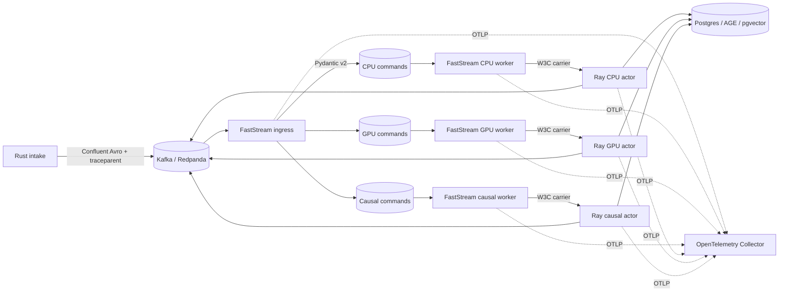

# Galadril Vision

Galadril Vision is a real-time, multi-tenant pipeline for multimodal inference,
entity resolution, graph persistence, and causal analysis.

## ESKG causal analysis

Scheduled causal workers materialize a tenant-scoped `ObservationWindow` from
raw ESKG events, state values, pgvector embeddings, and existing ontology or
derived relationships. Amarth jointly scalarizes these modalities, discovers
directional lagged dependencies with Tigramite PCMCI, and validates requested
effects with DoWhy.

## Probabilistic identity resolution

Identity resolution persists candidate evidence in PostgreSQL. Each prototype
carries its GOL value and a signed receipt. Gateway rechecks the receipt, live
resource and property permissions, Cedar conditions, and IFC obligations before
the value participates in similarity ranking. The `gol_state_symbol_key`
parameter names the prototype's declared GOL type.

Each native LI-ESKG ledger is in memory and closes after one calculation.
Durable native ledgers require provenance support and are rejected. Candidate
discovery reads the tenant and modality's indexed domain of signed prototypes.
Gateway approves bounded read batches using one fresh SpiceDB revision per
read-only decision. Gateway still checks GOL receipts, applicable Cedar
policies and IFC, and Vision scores each value inside its approved read scope.
The grant expires with that scope. Subsequent effects check live authorization.

Vision discovers, ranks and computes a proposed resolution before taking the
PostgreSQL advisory transaction lock. Under the lock, it compares the full
catalogue's row revisions and publishes only against an unchanged catalogue.
A concurrent insertion, deletion or update makes Vision rediscover and
recompute outside the lock. Configuration validation still requires
`ray.actor_replicas: 1`. A representative configuration is:

```yaml
identity_resolution:
  enabled: true
  candidate_top_k: 8
  h3_resolution: 9
  h3_ring_size: 1
  vector_similarity_midpoint: 0.85
  vector_similarity_scale: 12.0
  vector_weight: 1.0
  pipeline_probability_weight: 1.0
  candidate_log_prior: 0.0
  new_log_prior: 0.0
  noise_log_prior: -4.0
```

The bounded candidate pool currently uses up to 4096 signed prototypes. An
oversized pool refuses the operation. Existing unsigned prototypes remain
stored and are excluded from resolution. Spatial evidence comes from the
signed prototype. Unsigned identity and location joins cannot influence a
decision. Other vector query APIs retain their admission requirements.

## Identity resolution benchmarks

The standard CI lifecycle exercises the full service chain with a representative
retail and randomized-trial cohort. The separate benchmark uses the same
services and assertions with all 240 retail and 205 trial observations.

```sh
bazel test --config=ci //tests/e2e:pipeline_lifecycle_benchmark --nocache_test_results
```

Compare retail time to durable observations and to the final authorization
oracle using the elapsed times in the benchmark log. The OTLP spans
`vision.identity.sql.discover`, `vision.identity.gol.authorize`,
`vision.identity.similarity`, `vision.identity.lock.wait`, and
`vision.identity.sql.confirm` separate selection, authorization, scoring,
lock contention, and transactional confirmation.

## Architecture



## Observability

- Incoming W3C `traceparent` headers are extracted automatically by FastStream.
- The current context is serialized explicitly for Ray and extracted before the
  actor span starts, preserving the Trace ID across the process boundary.
- FastStream and pipeline latency, throughput, and active Ray task instruments
  are pushed directly to the OpenTelemetry Collector over OTLP.
- OTLP traces, metrics, and logs flow through the collector to Jaeger,
  Prometheus, and Loki. Prometheus scrapes only the collector's translated
  metrics endpoint; Vision does not run an HTTP server.
- JSON logs include `trace_id`, `span_id`, `entity_id`, `pipeline`, and `step`.
